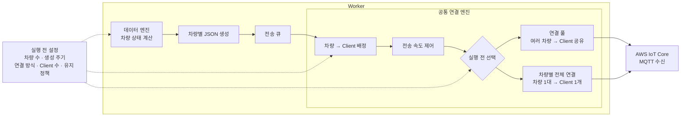

# 데이터 엔진부터 IoT Core까지

2026-11-16 확정 설계 흐름. 구현 예정이며 실제 전송 완료를 의미하지 않는다.

실선은 데이터 흐름, 점선은 설정 적용을 뜻한다. 한 실행에서는 연결 풀 또는 차량별 전체 연결 중 하나를 선택한다. 두 경로는 공통 연결 엔진의 선택 가능한 동작이며 별도 중계 서버를 의미하지 않는다. 실제 순서는 담당 Client에 배정한 뒤 전체·연결별 속도 제한을 거쳐 해당 연결로 발행한다.

- 데이터 엔진은 차량별 상태와 운행 시각을 유지하며 지정 주기로 JSON을 생성한다.
- 전송 큐는 처리할 메시지를 제한된 크기로 보관한다.
- 공통 연결 엔진은 고정 배정표, 접속·인증·전송 속도·재연결을 관리한다.
- 차량 ID는 데이터 식별, Client ID는 MQTT 접속 식별이다. 풀로 변경해도 차량별 JSON을 자동 합치지 않는다.
- 연결 수·배정 방식·배정표는 실행 중 변경하지 않는다. 다른 설정은 별도 실행으로 비교한다.
- 운행 중 접속/해제와 장애 재연결은 시작할 때 정한 유지·복구 정책을 따른다. 설정 수가 고정되어도 실제 연결 성공 수는 달라질 수 있다.
- QoS 1 PUBACK는 IoT Core 수신 확인으로 집계한다. 후속 파이프라인 검증은 포함하지 않는다.
